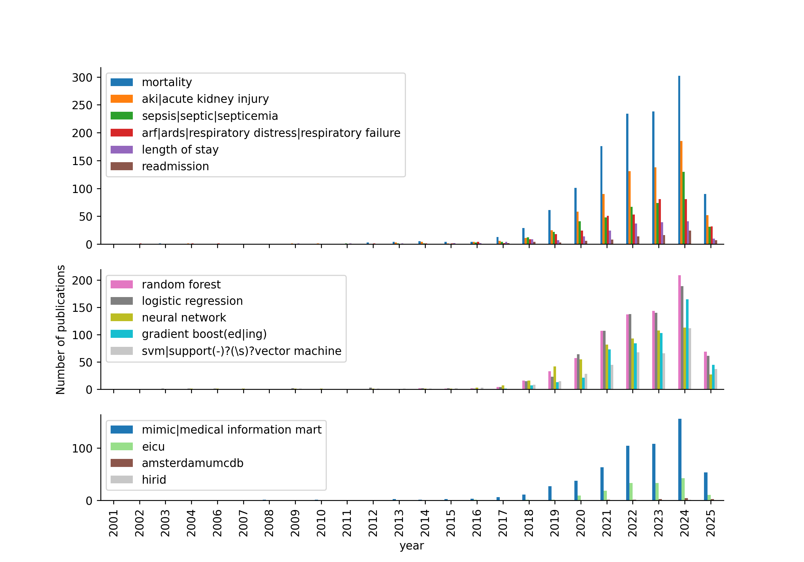

<div align="center">
  
# Continual Learning in EHR - Literature Review

 [](https://opensource.org/licenses/gpl-3-0)  

</div>

Code for lit review scan and graphics. To fetch current literature data and visualise it, clone the repo and run the following: 

```zsh
uv run pubstats.py
```

Resuslts are available in `/results`:


